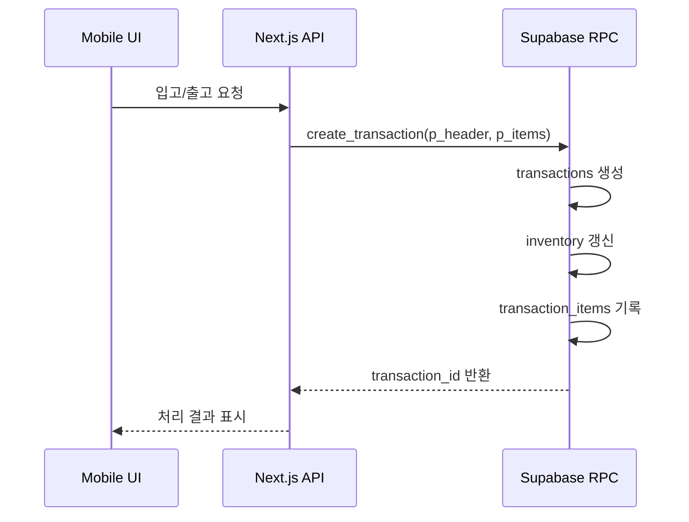

# 모바일 재고·거래 관리 서비스 (stock-cock)

중소 제조 현장에서 재고 수량과 입·출고 이력을 모바일로 확인하고 기록할 수 있도록 만든 재고·거래 관리 웹 애플리케이션입니다.

- 배포 서비스: [stock-cock.vercel.app](https://stock-cock.vercel.app) - 로그인 필요
- 소스 저장소: [enjoylonelines/stock-cock](https://github.com/enjoylonelines/stock-cock)
- 주요 개발 기간: 2025.03 - 2026.02

> 배포 URL은 로그인 화면 접근까지 확인했습니다. 공개 README에서는 실사용 데이터, 운영 계정, 회사 식별 정보는 노출하지 않습니다.

## 프로젝트 한눈에 보기

| 구분 | 내용 |
| --- | --- |
| 문제 | 창고 재고와 입·출고 이력을 현장에서 바로 확인하기 어려워 수기 확인, 기록 누락, 책임 추적 문제가 발생했습니다. |
| 목표 | 모바일에서 재고 조회, 입고, 출고, 이동, 조정을 처리하고 거래 이력을 남기는 업무 흐름을 만드는 것이 목표였습니다. |
| 담당 | 기획, 화면 설계, Next.js 구현, Supabase DB·인증·Storage 구성, PWA 배포, 재고 변경 트랜잭션 보강을 담당했습니다. |
| 결과 | 로그인 기반 모바일 업무 화면, 재고 현황, 거래 이력, 입·출고·이동·조정 플로우, 푸시 알림 기반 운영 보조 기능을 구현했습니다. |
| 한계 | 운영 DB 동시성, rollback, 음수 재고 방지는 별도 통합 검증이 필요하며, 공개 문서에서는 확인된 구현 경계까지만 설명합니다. |

## 화면

<p align="center">
  
  
</p>

## 핵심 기능

- 모바일 우선 재고 조회와 제품 검색
- 입고, 출고, 재고 이동, 재고 조정 업무 플로우
- 거래 이력 조회와 당일 입고·출고·조정 수량 요약
- 원재료 사용량 집계와 완제품/원재료 단위 분리
- Supabase 인증, DB, Storage 기반 사용자별 데이터 관리
- PWA 설치, Service Worker, 푸시 알림
- loading, error, disabled 상태를 포함한 입력 검증 UI

## 기술 스택

| 분류 | 기술 |
| --- | --- |
| Language | TypeScript |
| Framework | Next.js App Router |
| UI | Tailwind CSS, shadcn/ui |
| State | Zustand, SWR |
| Backend | Supabase Auth, PostgreSQL, Storage, RPC |
| PWA | next-pwa, Service Worker, Web Push |
| Test | Jest |
| Deploy | Vercel |

## 설계 포인트

### 1. 재고 변경을 DB 트랜잭션 경계로 이동

초기 입·출고 흐름은 API에서 거래 생성, 재고 조회, 재고 갱신, 거래 품목 기록을 순차 처리했습니다. 이후 `create_transaction(p_header, p_items)` Supabase RPC로 옮겨 거래 헤더, 품목별 재고 갱신, 거래 이력 기록을 하나의 DB 함수 안에서 처리하도록 보강했습니다.



이 변경은 화면 상태와 DB 상태의 책임을 분리하기 위한 작업입니다. 다만 동시 요청 제어와 운영 rollback 검증은 별도 과제로 남겼습니다.

### 2. 모바일 현장 사용성을 우선한 PWA

별도 앱 설치와 배포 심사를 피하고, 현장 사용자가 URL 접근 후 바로 사용할 수 있도록 PWA를 선택했습니다. iOS standalone meta, Service Worker 갱신, 푸시 구독 관리처럼 모바일 웹앱에서 자주 깨지는 지점을 별도로 보강했습니다.

### 3. 서버 상태와 화면 상태 분리

제품, 재고, 거래 이력처럼 서버에서 다시 읽어야 하는 데이터는 SWR로 관리하고, 드로어, 필터, 폼 입력처럼 화면 맥락에 가까운 상태는 Zustand와 컴포넌트 상태로 분리했습니다.

## 검증과 문서

- [제품 업무 흐름 근거](./docs/portfolio/PRODUCT_WORKFLOW_EVIDENCE.md)
- [트랜잭션 정합성 보강 기록](./docs/portfolio/TRANSACTION_INTEGRITY_EVIDENCE.md)
- [실사용 업무 사례 정리](./docs/portfolio/REAL_USER_CASE_STUDY.md)
- [기술 Q&A](./docs/TECH_QA.md)
- [보강 전략](./docs/STOCK_COCK_REINFORCEMENT_STRATEGY.md)

## 실행 방법

```bash
pnpm install
pnpm dev
pnpm test
pnpm build
```

로컬 Supabase 환경 변수는 `.env.local`에 별도로 설정합니다. 실제 키와 운영 계정 정보는 저장소에 커밋하지 않습니다.

## 라이선스

MIT
