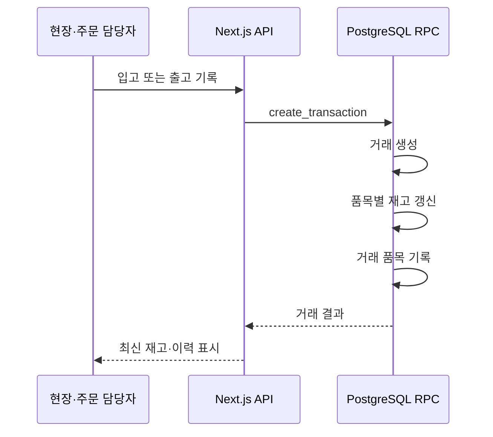

# Stock-Cock | 제조 현장 재고·거래 관리 서비스

현장과 주문 담당자가 **장소 제약 없이 현재 재고와 입·출고 이력을 확인하고 기록**할 수 있도록 만든 모바일 우선 웹 서비스입니다.

완제품과 원재료를 엑셀로 나누어 관리하던 과정에서는 변경 시점과 담당자를 확인하기 어려웠고, 급한 주문·샘플 출고·생산 계획을 검토할 때마다 창고 확인이 필요했습니다. Stock-Cock은 이 업무 흐름을 재고 현황, 거래 기록, 조정 사유로 연결했습니다.

- 서비스: [stock-cock.vercel.app](https://stock-cock.vercel.app) — 로그인 필요
- 저장소: [enjoylonelines/stock-cock](https://github.com/enjoylonelines/stock-cock)
- 역할: 기획, 화면 설계, Next.js·Supabase 기반 서버 및 데이터 흐름 구현, PWA 배포

> 공개 README에는 운영 계정·실사용 데이터·회사 식별 정보를 포함하지 않습니다.

## 한눈에 보기

| 항목 | 내용 |
| --- | --- |
| 문제 | 엑셀 변경 이력을 신뢰하기 어려워 주문·창고·생산 담당자가 재고를 다시 확인해야 했습니다. |
| 사용자 가치 | 현재고와 최근 거래를 모바일에서 확인하고, 입고·출고·이동·조정 사유를 기록합니다. |
| 핵심 판단 | 완제품과 원재료는 단위와 확인 목적이 달라 화면과 집계 기준을 분리했습니다. |
| 데이터 흐름 | 입출고는 거래 생성·재고 갱신·거래 품목 기록을 하나의 DB 함수에서 처리합니다. |
| ERP 서버 보강 | 운영 서비스와 분리된 [`feature/erp-domain-lab`](https://github.com/enjoylonelines/stock-cock/tree/feature/erp-domain-lab) 브랜치에서 TypeScript·PostgreSQL 기반 전표 서버를 구현했습니다. |

## 실제 업무 흐름

<table>
  <tr>
    <td width="33.3%" align="center" valign="top">
      <strong>01. 재고·거래 이력 확인</strong><br />
      <sub>로그인 → 현재고 요약 → 최근 거래 조회</sub><br /><br />
      
    </td>
    <td width="33.3%" align="center" valign="top">
      <strong>02. 제품과 초기 재고 등록</strong><br />
      <sub>제품 유형·창고·초기 수량 입력</sub><br /><br />
      
    </td>
    <td width="33.3%" align="center" valign="top">
      <strong>03. 입고 기록과 이력 반영</strong><br />
      <sub>창고·제품·수량 입력 → 거래 이력 확인</sub><br /><br />
      
    </td>
  </tr>
</table>

**사용 흐름:** 주문·생산·창고 담당자가 현재고를 확인하고, 필요한 품목을 등록한 뒤 입출고·이동·조정을 기록합니다. 서비스는 품목·창고별 현재 수량, 거래 이력, 조정 사유를 남깁니다.

GIF는 로컬 Supabase fixture에서 실제 로그인·폼 입력·조회 흐름을 녹화한 자료입니다. 첫 번째 영상은 로그인·조회 과정을, 제품 등록과 입고 영상은 로컬 DB 기록 과정을 보여줍니다.

## TypeScript ERP 서버 개발 보강

> 구현 브랜치: [`feature/erp-domain-lab`](https://github.com/enjoylonelines/stock-cock/tree/feature/erp-domain-lab)

운영 Stock-Cock 서비스의 화면·업무 흐름을 바탕으로, 전표 처리에서 필요한 서버 책임을 별도 TypeScript 서버로 확장했습니다. HTTP 요청 처리·업무 규칙·PostgreSQL 접근 계층을 명확히 나눠 전표 처리 흐름을 구성했습니다.

```text
HTTP 요청
  → TypeScript 전표 워크플로우
  → PostgreSQL 전표·원장·현재고 처리
  → 전표 결과 및 재고 가용량 응답
```

- Node.js `node:http` 기반 HTTP 서버로 전표 생성·확정·반영·역분개 API를 구현했습니다.
- `DRAFT → CONFIRMED → POSTED → REVERSED` 상태 전이를 전표 워크플로우 서비스에 두었습니다.
- PostgreSQL 포트에서 전표 상태, 원장 항목, 현재고를 하나의 처리 단위로 반영했습니다.
- 입고·출고·이동 시 입력 단위를 보존하고, 원장과 현재고에는 기준 단위로 정규화했습니다.
- 재고 가용량 조회에는 직접 구현한 LRU Cache를 적용하고, 전표 반영·역분개 뒤 관련 키를 무효화했습니다.

| 확인 대상 | 구현 위치 |
| --- | --- |
| TypeScript HTTP 서버 | [`http-server.ts`](https://github.com/enjoylonelines/stock-cock/blob/feature/erp-domain-lab/labs/erp-domain/ecount/backend/src/http-server.ts) |
| 전표 워크플로우 | [`inventory-document-workflow.ts`](https://github.com/enjoylonelines/stock-cock/blob/feature/erp-domain-lab/labs/erp-domain/ecount/backend/src/inventory-document-workflow.ts) |
| PostgreSQL 접근 계층 | [`postgres-workflow-port.ts`](https://github.com/enjoylonelines/stock-cock/blob/feature/erp-domain-lab/labs/erp-domain/ecount/backend/src/postgres-workflow-port.ts) |
| 전표·원장 스키마 | [`001_inventory_document_schema.sql`](https://github.com/enjoylonelines/stock-cock/blob/feature/erp-domain-lab/labs/erp-domain/ecount/sql/001_inventory_document_schema.sql) |
| HTTP 통합 검증 | [`http_integration.py`](https://github.com/enjoylonelines/stock-cock/blob/feature/erp-domain-lab/labs/erp-domain/ecount/test/http_integration.py) |

## 문제를 데이터 흐름으로 바꾼 판단

### 1. 입출고 기록과 재고 갱신을 같은 처리 단위로 관리

입출고는 화면에서 성공으로 보이더라도 거래 이력과 현재 재고가 따로 갱신되면 신뢰하기 어렵습니다. 그래서 입출고 API는 `create_transaction` DB 함수를 호출해 거래 생성, 품목 기록, 재고 갱신을 하나의 처리 단위로 수행하도록 구성했습니다.



재고 조정과 창고 간 이동은 각각 별도 API 경로에서 처리하며, 오류를 사용자에게 반환하고 거래 알림 실패는 본 처리와 분리해 기록합니다.

### 2. 완제품과 원재료를 같은 목록으로 취급하지 않음

완제품은 주문·출고 시 수량 확인이 중심이고, 원재료는 입고 단위와 사용량 확인이 중심입니다. 두 데이터의 단위와 조회 이유가 달라 제품 유형, 화면 탭, 집계 기준을 분리했습니다. 이를 통해 원재료 추가 요구가 생겼을 때 기존 완제품 흐름을 훼손하지 않고 확장할 수 있었습니다.

### 3. 현장 사용 환경에 맞춘 모바일 웹

별도 앱 설치 없이 링크 접근으로 시작할 수 있도록 PWA를 선택했습니다. 모바일에서 재고를 빠르게 조회하고 입력할 수 있게 했으며, 폼 입력·필터·드로어 같은 화면 상태와 제품·재고·거래 이력 같은 서버 상태를 분리했습니다.

## 구현 범위

### 업무 기능

- 품목·창고별 재고 조회 및 검색
- 완제품·원재료 분리 관리와 단위별 수량·중량 처리
- 입고, 출고, 창고 이동, 재고 조정
- 거래 이력과 당일 입고·출고·조정 요약
- 사용자 인증, 이미지 저장, 웹 푸시 알림

### 기술 구성

| 구분 | 사용 기술 |
| --- | --- |
| Frontend | TypeScript, Next.js App Router, React, Tailwind CSS, shadcn/ui |
| 상태 관리 | SWR, Zustand |
| 운영 서비스 Backend / DB | Next.js Route Handler, Supabase Auth, PostgreSQL, Storage, RPC |
| ERP 서버 보강 | TypeScript, Node.js `node:http`, PostgreSQL, LRU Cache — `feature/erp-domain-lab` |
| 품질 / 배포 | Jest, Biome, PWA Service Worker, Web Push, Vercel |

## 코드와 문서 안내

| 확인 대상 | 위치 |
| --- | --- |
| 입출고 API와 DB 함수 호출 | [`src/app/api/transactions/route.ts`](./src/app/api/transactions/route.ts) |
| 재고 조정 API | [`src/app/api/adjustments/route.ts`](./src/app/api/adjustments/route.ts) |
| 재고 갱신 유틸리티 | [`src/utils/inventory.ts`](./src/utils/inventory.ts) |
| 거래 DB 함수 마이그레이션 | [`supabase/migrations/20260131110000_fix_create_transaction_rpc_signature.sql`](./supabase/migrations/20260131110000_fix_create_transaction_rpc_signature.sql) |
| 로컬 Supabase 설정 | [`docs/SUPABASE_SETUP.md`](./docs/SUPABASE_SETUP.md) |
| 기술 설계 기록 | [`docs/TECHNICAL_DESIGN_DECISIONS.md`](./docs/TECHNICAL_DESIGN_DECISIONS.md) |

## 실행

```bash
pnpm install
pnpm dev
```

검사와 프로덕션 빌드:

```bash
pnpm lint
pnpm test
pnpm build
```

로컬 Supabase 환경 변수는 `.env.local`에 설정합니다. 실제 서비스 키와 계정 정보는 저장소에 포함하지 않습니다.

## 라이선스

MIT
