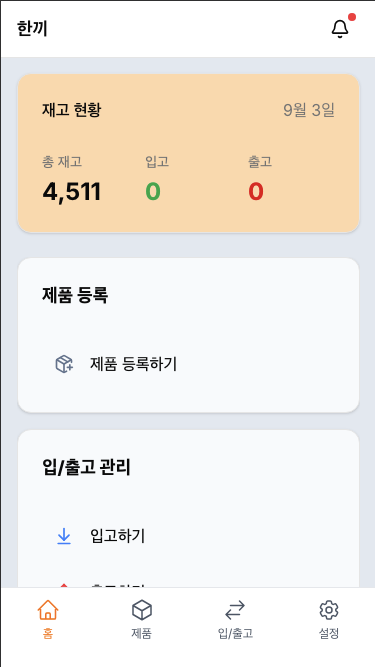
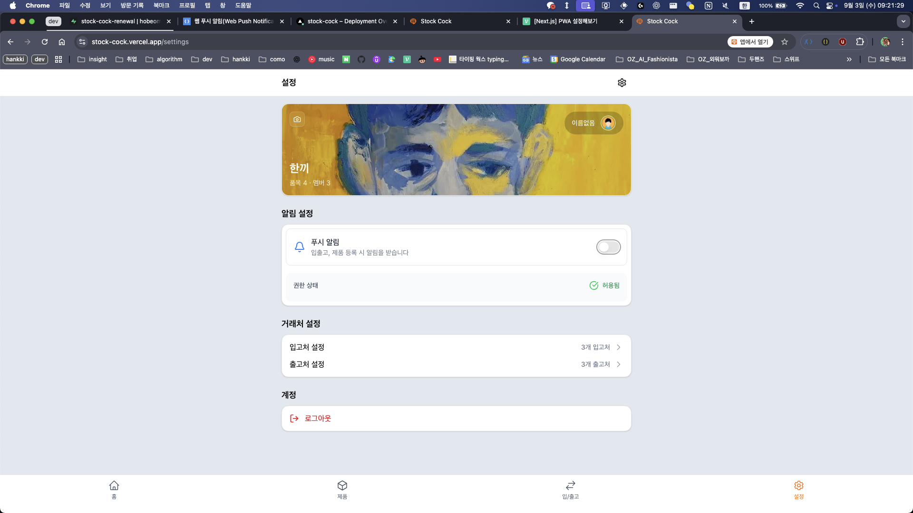
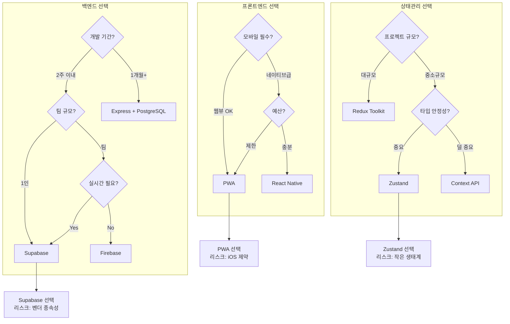
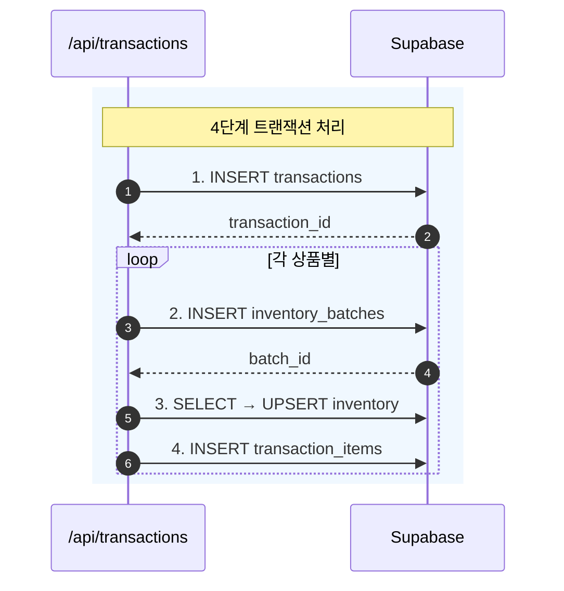
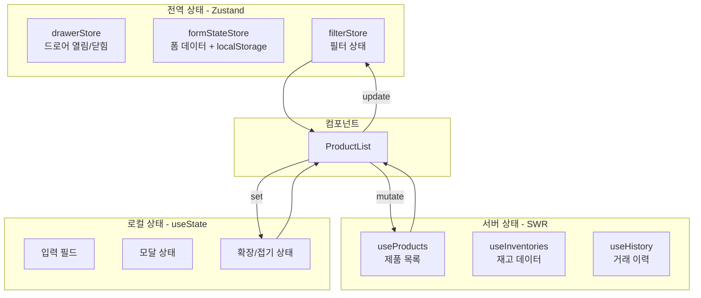
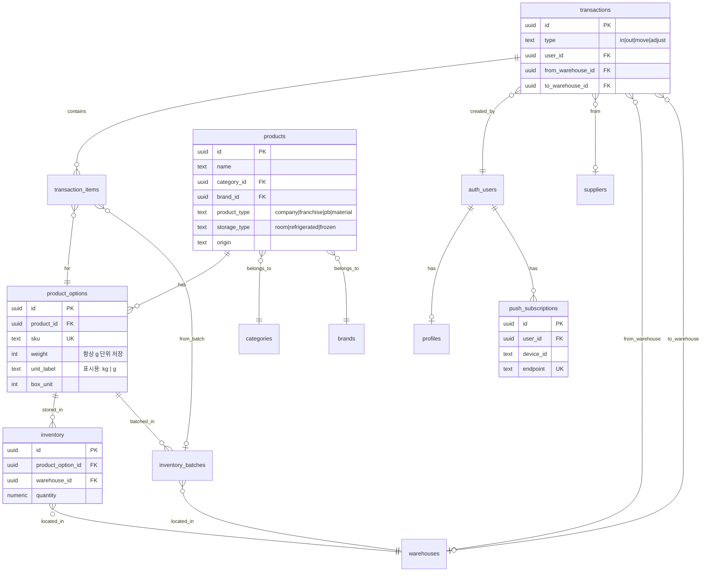
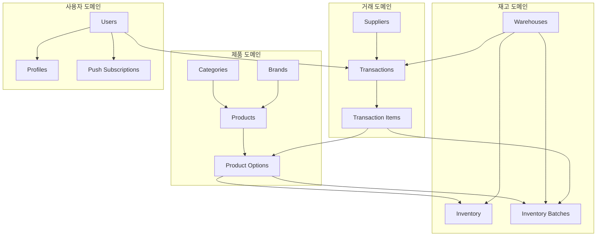

# Stock Management System

> 중소 제조기업의 창고 재고 관리 비효율을 개선하기 위해 기획·설계·개발한 재고관리 웹 애플리케이션

**Live Demo**: [stock-cock.vercel.app](https://stock-cock.vercel.app)

<p align="center">
  
  
</p>

현장 근무자가 모바일에서도 즉시 재고를 확인하고 입·출고 내역을 기록할 수 있도록 PWA를 도입했으며, 푸시 알림을 통해 재고 변동을 실시간으로 전달합니다.

---

## 목차

- [문제 정의](#문제-정의)
- [핵심 기능](#핵심-기능)
- [기술 선택과 트레이드오프](#기술-선택과-트레이드오프)
- [도전적 구현](#도전적-구현)
- [상태 설계](#상태-설계)
- [DB 아키텍처](#db-아키텍처)
- [트러블슈팅](#트러블슈팅)
- [개선 계획](#개선-계획)

---

## 문제 정의

| 문제                                   | 영향                   |
| -------------------------------------- | ---------------------- |
| 재고 수량을 실시간으로 파악하기 어려움 | 재고 부족/과잉 발생    |
| 입·출고 이력이 명확히 기록되지 않음    | 책임 추적 불가능       |
| 하루 생산량이 정확히 집계되지 않음     | 생산 계획 수립 어려움  |
| 발주량을 데이터 기반으로 산정하지 못함 | 매번 수기 확인 후 결정 |

---

## 핵심 기능

- 웹 및 모바일 환경에서 재고 관리 기능 제공
- PWA 기반 푸시 알림을 통한 재고 변동 알림
- 입고 / 출고 / 조정 / 창고 이동 CRUD 기능
- 입·출고 내역 히스토리 조회
- 원재료를 포함한 전체 재고 목록 관리
- 홈 대시보드 StatsBox: 당일 입고/출고/조정 수량 및 **원재료 사용량(당일 출고 g→kg)** 표시
- 주요 비즈니스 로직에 대한 테스트 코드 작성

---

## 기술 선택과 트레이드오프

단순히 "이 기술을 사용했다"가 아니라, **프로젝트 규모와 제약 조건을 고려해 어떤 리스크를 감수하고 선택했는지** 설명합니다.

### 백엔드: Supabase

```
고려한 선택지: Express + PostgreSQL | Firebase | Supabase
```

| 구분              | 내용                                                                 |
| ----------------- | -------------------------------------------------------------------- |
| **결정**          | Supabase                                                             |
| **감수한 리스크** | 벤더 종속성, 복잡한 비즈니스 로직 구현 제한, 마이그레이션 비용       |
| **얻은 것**       | 2주 내 MVP 완성, RLS 기반 보안, 실시간 기능 내장, 인증/스토리지 통합 |

**선택 이유**: 1인 개발 + 2주라는 제약 조건에서 백엔드 인프라 구축에 시간을 쓰는 것은 비효율적이라고 판단했습니다. 벤더 종속성이라는 리스크를 감수하더라도 핵심 기능 개발에 집중하는 것이 MVP 단계에서 더 중요했습니다.

---

### 클라이언트: PWA (next-pwa)

```
고려한 선택지: React Native | Flutter | PWA
```

| 구분              | 내용                                                                |
| ----------------- | ------------------------------------------------------------------- |
| **결정**          | PWA                                                                 |
| **감수한 리스크** | iOS 푸시 알림 제한, iOS PWA 세션 분리 문제, 네이티브 기능 접근 제한 |
| **얻은 것**       | 단일 코드베이스, 앱스토어 배포 비용 0원, 웹 접근성, 즉시 업데이트   |

**선택 이유**: 현장 근무자가 "설치 없이 바로 사용"할 수 있어야 했습니다. React Native로 네이티브 앱을 개발하면 더 좋은 UX를 제공할 수 있지만, 학습 비용과 배포 과정의 복잡성을 고려했을 때 PWA가 MVP에 적합했습니다. iOS의 제약사항은 트러블슈팅으로 대응했습니다.

---

### 상태 관리: Zustand

```
고려한 선택지: Redux Toolkit | Recoil | Zustand | Context API
```

| 구분              | 내용                                                                                                  |
| ----------------- | ----------------------------------------------------------------------------------------------------- |
| **결정**          | Zustand                                                                                               |
| **감수한 리스크** | 상대적으로 작은 생태계, 미들웨어/DevTools 제한                                                        |
| **얻은 것**       | Redux의 4개 파일(slice, action, reducer, selector)을 1개 store로 통합, 1KB 미만 번들, Provider 불필요 |

**선택 이유**: 이 프로젝트의 전역 상태는 드로어 열림/닫힘, 필터, 폼 데이터 정도로 복잡하지 않습니다. Redux의 보일러플레이트는 과도했고, Context API는 불필요한 리렌더링 문제가 있었습니다. Zustand는 "필요한 만큼만" 사용할 수 있어 프로젝트 규모에 적합했습니다.

---

### 데이터 페칭: SWR

```
고려한 선택지: React Query | SWR | useEffect + fetch
```

| 구분              | 내용                                                    |
| ----------------- | ------------------------------------------------------- |
| **결정**          | SWR                                                     |
| **감수한 리스크** | React Query 대비 기능 제한 (Mutation 관리, DevTools)    |
| **얻은 것**       | 자동 캐싱, 중복 요청 제거, 포커스 시 재검증, 간결한 API |

**선택 이유**: 여러 컴포넌트에서 동일한 데이터(제품 목록, 재고)를 참조하는 구조에서 캐싱과 중복 요청 제거가 필수였습니다. React Query가 더 강력하지만, SWR의 간결한 API가 이 프로젝트 규모에 더 적합했습니다.

---

### 기술 선택 의사결정 흐름



---

## 도전적 구현

**라이브러리에 의존하지 않고 직접 설계·구현한 부분**을 설명합니다.

### 1. PWA 푸시 알림 직접 구현

Service Worker를 직접 작성하여 푸시 알림을 구현했습니다. 다양한 데이터 형식과 에러 상황에 대응하기 위해 **다단계 폴백 로직**을 설계했습니다.

```typescript
// worker/index.ts
sw.addEventListener("push", (event: PushEvent) => {
  try {
    let data = {};

    if (event.data) {
      try {
        // 1차: JSON 파싱 시도
        data = event.data.json();
      } catch {
        // 2차: 텍스트로 폴백
        const text = event.data.text();
        if (text) {
          event.waitUntil(sw.registration.showNotification("알림", { body: text }));
          return;
        }
      }
    } else {
      // 3차: 데이터 없으면 기본 알림
      event.waitUntil(sw.registration.showNotification("알림", { body: "새 알림이 있습니다" }));
      return;
    }

    // 정상 처리
    event.waitUntil(sw.registration.showNotification(data.title, options));
  } catch {
    // 4차: 최종 폴백
    event.waitUntil(sw.registration.showNotification("알림", { body: "새 알림이 있습니다" }));
  }
});
```

---

### 2. 디바이스별 푸시 구독 관리

**문제**: 동일 계정으로 여러 디바이스에서 로그인 시 푸시 알림이 마지막 디바이스에만 전송됨

**원인**: `user_id` 기준으로 단일 구독 정보를 저장하여 덮어쓰기 발생

**해결**: `user_id + device_id` 복합키로 구독 정보를 분리 저장

```typescript
// 기존 구독 확인 후 중복 제거
const { data: existingSubscriptions } = await supabase
  .from("push_subscriptions")
  .select("*")
  .eq("user_id", user.id)
  .eq("device_id", deviceInfo.device_id);

// 같은 디바이스의 다른 endpoint가 있으면 삭제
if (existingSubscriptions?.length > 0) {
  const oldEndpoints = existingSubscriptions.filter((sub) => sub.endpoint !== subscription.endpoint).map((sub) => sub.endpoint);

  if (oldEndpoints.length > 0) {
    await supabase
      .from("push_subscriptions")
      .delete()
      .eq("user_id", user.id)
      .eq("device_id", deviceInfo.device_id)
      .in("endpoint", oldEndpoints);
  }
}
```

구독 해제 시에도 **다단계 폴백**을 적용했습니다:

1. `device_id`로 삭제 시도
2. 실패 시 `endpoint`로 삭제 시도
3. 최종 실패 시 `user_id`로 전체 삭제

---

### 3. 상태 지속성 커스텀 구현

Zustand의 `persist` 미들웨어 대신 **커스텀 직렬화 로직**을 구현하여 더 세밀한 제어를 가능하게 했습니다.

```typescript
// Date 객체 자동 복원 (필드명에 "Date" 포함 시)
const loadFromStorage = <T>(key: string, defaultState: T): T => {
  if (typeof window === "undefined") return defaultState; // SSR 안전성

  const stored = localStorage.getItem(key);
  if (!stored) return defaultState;

  const parsed = JSON.parse(stored);

  // Date 필드 자동 복원
  Object.keys(parsed).forEach((k) => {
    if (k.includes("Date") && typeof parsed[k] === "string") {
      parsed[k] = new Date(parsed[k]);
    }
  });

  return parsed;
};

// File 객체 제외 처리 (직렬화 불가)
const saveToStorage = <T>(key: string, state: T): void => {
  const stateToSave = { ...state };
  if ("imageFile" in stateToSave) stateToSave.imageFile = undefined;
  if ("localPreviewUrl" in stateToSave) stateToSave.localPreviewUrl = undefined;

  localStorage.setItem(key, JSON.stringify(stateToSave));
};
```

**이 구현으로 해결한 문제**:

- 폼 작성 중 새로고침해도 데이터 유지
- Date 객체가 문자열로 변환되는 문제 자동 해결
- File 객체로 인한 직렬화 오류 방지

---

### 4. 4단계 트랜잭션 처리

입·출고 시 데이터 일관성을 보장하기 위해 **4단계 순차 처리**를 구현했습니다.



```typescript
// 3단계: inventory upsert (조회 후 업데이트/생성 분기)
const { data: inventory } = await supabase
  .from("inventory")
  .select("*")
  .eq("product_option_id", item.option_id)
  .eq("warehouse_id", warehouse_id)
  .maybeSingle();

let signedQty = item.quantity;
if (type === "out") signedQty = -item.quantity;

const newQty = (inventory?.quantity ?? 0) + signedQty;

if (inventory) {
  await supabase.from("inventory").update({ quantity: newQty }).eq("id", inventory.id);
} else {
  await supabase.from("inventory").insert([
    {
      product_option_id: item.option_id,
      warehouse_id,
      quantity: newQty,
    },
  ]);
}
```

---

## 상태 설계

단순히 UI 상태를 boolean으로 관리하는 방식 대신, **재고 조정의 맥락을 포함한 상태 모델**을 설계했습니다.

### 계층적 상태 분리



### 상태 분리 원칙

| 구분             | 도구     | 예시             | 이유                                           |
| ---------------- | -------- | ---------------- | ---------------------------------------------- |
| **전역 UI 상태** | Zustand  | 드로어, 필터, 폼 | 여러 컴포넌트에서 공유, localStorage 연동 필요 |
| **서버 상태**    | SWR      | 제품, 재고, 이력 | 캐싱, 재검증, 중복 요청 제거 필요              |
| **로컬 상태**    | useState | 입력 필드, 모달  | 해당 컴포넌트에서만 사용                       |

이 분리를 통해:

- **재사용성**: 서버 상태는 여러 컴포넌트에서 공유
- **성능**: SWR이 자동으로 캐싱 및 중복 요청 제거
- **유지보수**: 각 상태의 책임이 명확

### 도메인 레이어

DB 뷰(Supabase Row)는 null 가능·snake_case·물리 스키마에 묶여 있으므로, `src/types/domain.ts`와 `src/lib/domain/`에서 **도메인 타입**(`DomainInventoryItem`, `StockUnit` 등)과 변환·포맷 함수를 두었다. 뷰 Row는 `toInventoryItem`으로 한 번 변환한 뒤 UI에서 사용하고, 재고/규격 표시는 `formatStock`, `formatSpecWeight`, `formatWeight` 등으로 중앙화해 null 처리와 단위 추론을 한곳에서 관리한다.

---

## DB 아키텍처

### ERD



### 논리적 데이터 흐름



---

## 트러블슈팅

### 1. PWA 푸시 알림 구독 문제

| 구분     | 내용                                                                |
| -------- | ------------------------------------------------------------------- |
| **문제** | 동일 계정으로 다른 디바이스에서 로그인 시 푸시 알림이 수신되지 않음 |
| **원인** | 사용자 ID 기준으로 단일 푸시 구독 정보를 저장하여 덮어쓰기 발생     |
| **해결** | `user_id + device_id` 복합키로 구독 정보 분리 저장                  |

### 2. iOS PWA 세션 문제

| 구분     | 내용                                                                      |
| -------- | ------------------------------------------------------------------------- |
| **문제** | iOS 환경에서 PWA 앱 종료 시 세션이 유지됨에도 로그아웃됨                  |
| **원인** | iOS PWA의 세션 공유 정책으로 브라우저와 앱 간 세션이 분리되어 관리됨      |
| **대응** | 세션 만료 조건과 로그인 상태 관리 방식을 조정하여 사용자 경험 저하 최소화 |

### 3. 모바일 키보드 뷰포트 이슈

| 구분     | 내용                                                                 |
| -------- | -------------------------------------------------------------------- |
| **문제** | iOS에서 키보드가 열릴 때 드로어 높이가 비정상적으로 변경됨           |
| **원인** | `visualViewport` API의 resize 이벤트가 키보드 높이만큼 뷰포트를 줄임 |
| **해결** | `userAgent`로 iOS 감지 후 해당 기기에서만 뷰포트 조정 로직 적용      |

### 4. 원재료/완제품 재고 단위 혼재 문제

| 구분     | 내용                                                                                 |
| -------- | ------------------------------------------------------------------------------------ |
| **문제** | 완제품(봉지 수)과 원재료(kg)가 같은 `quantity` 컬럼 사용, 단위 의미 혼재             |
| **원인** | 초기 설계 시 원재료 관리 요구사항 미반영, 동일 필드에 다른 의미의 값 저장            |
| **해결** | `weight_in_grams` 컬럼 분리, 원재료는 g 단위로 저장하여 정수 관리 (소수점 오차 방지) |

**설계 결정 과정**:

1. 같은 테이블 + nullable 컬럼 vs 별도 테이블 분리 검토
2. 완제품/원재료의 공통 로직(입출고, 재고 조회)이 많아 같은 테이블 유지 선택
3. `product_type = 'material'`일 때 `weight_in_grams` 사용, 그 외는 `quantity` 사용

### 5. iOS "홈 화면에 추가" 후 앱처럼 동작하지 않음

| 구분     | 내용                                                                                                                      |
| -------- | ------------------------------------------------------------------------------------------------------------------------- |
| **문제** | Safari에서 PWA를 홈 화면에 추가해도 주소창이 보이는 북마크 형태로 열림                                                    |
| **원인** | iOS는 manifest보다 HTML meta를 우선 참조하며, `apple-mobile-web-app-capable` 미설정 시 standalone 미적용                  |
| **해결** | `layout.tsx`에 `apple-mobile-web-app-capable`, `apple-mobile-web-app-title` 등 meta 태그 추가, manifest `short_name` 통일 |

### 6. PWA 배포 후에도 구버전이 보이는 현상

| 구분     | 내용                                                                                     |
| -------- | ---------------------------------------------------------------------------------------- |
| **문제** | 배포 후에도 이전 JS가 실행되며 오류 발생                                                 |
| **원인** | Service Worker가 예전 자산을 캐시해 새 버전으로 전환되지 않음                            |
| **해결** | `ServiceWorkerReload`에서 `controllerchange` 시 `location.reload()`로 자동 새로고침 처리 |

### 7. 입출고 내역이 목록에 안 나오던 문제

| 구분     | 내용                                                                                                                                                                               |
| -------- | ---------------------------------------------------------------------------------------------------------------------------------------------------------------------------------- |
| **문제** | 재고 화면에서 입출고 내역이 비어 있음                                                                                                                                              |
| **원인** | (1) SWR key가 `inventories.length > 0`일 때만 설정되어 재고 없을 때 fetch 미실행 (2) `processTransactionData` 내 `.map` 콜백에 `index` 미전달로 ReferenceError → grouped undefined |
| **해결** | key를 `["inventory-history", inventories.length]`로 고정, `.map((tx, index) => ...)`로 index 전달                                                                                  |

### 8. Supabase 조인 결과가 객체일 때 StatsBox 분류 오류

| 구분     | 내용                                                                                                                                            |
| -------- | ----------------------------------------------------------------------------------------------------------------------------------------------- |
| **문제** | StatsBox에서 출고와 원재료 사용량이 구분되지 않고 잘못 집계됨                                                                                   |
| **원인** | PostgREST가 many-to-one 관계를 단일 객체로 반환해 `product_options?.[0]`가 undefined가 되는 경우 존재                                           |
| **해결** | `getProductType(item)`에서 `Array.isArray(po) ? po[0] : po`로 객체/배열 모두 처리해 `product_type` 추출 후 출고(완제품)와 원재료 사용량(g) 분리 |

### 9. 입출고 API: N번 호출을 RPC로 줄이기 + inventory_batches·transaction_items 통합 + 시그니처 불일치

**배경**: 입출고 시 트랜잭션 1건 INSERT → 품목마다 inventory_batches / inventory UPSERT / transaction_items INSERT처럼 **N번의 API·DB 왕복**이 필요했고, 이를 한 번의 RPC로 묶기로 했다. 이에 맞춰 DB도 단순화했다. **inventory_batches** 테이블을 제거하고, **transaction_items**에서 `batch_id` FK를 없애서, 입출고 한 건이 **transactions + transaction_items + inventory** 세 테이블만으로 처리되도록 통합했다. `create_transaction(p_header, p_items)` RPC에서 트랜잭션 INSERT → 품목 루프로 inventory UPSERT·transaction_items INSERT까지 한 트랜잭션 안에서 수행한다.

**그 과정에서 발생한 문제**:

| 구분     | 내용                                                                                                                                            |
| -------- | ----------------------------------------------------------------------------------------------------------------------------------------------- |
| **문제** | 입출고 요청 시 500 에러. "No function matches the given name and argument types. You might need to add explicit type casts."                   |
| **원인** | RPC를 `p_items jsonb[]`로 정의했는데, Supabase/PostgREST는 요청 본문의 JSON 배열을 **원소별 PostgreSQL 배열(jsonb[])** 이 아니라 **배열 전체를 담은 하나의 jsonb**로 전달함. |
| **해결** | 시그니처를 `p_items jsonb`로 변경. 함수 내부는 `jsonb_array_elements(p_items)`로 그대로 루프. 마이그레이션: `20260131110000_fix_create_transaction_rpc_signature.sql`. |

**추가 현상**: 수정 후 "Could not choose the best candidate function between: ...(jsonb), ...(jsonb[])" 에러.

| 구분     | 내용                                                                                                                                            |
| -------- | ----------------------------------------------------------------------------------------------------------------------------------------------- |
| **원인** | `CREATE OR REPLACE`는 인자 타입이 다르면 기존 함수를 대체하지 않고 **새 오버로드**로 추가됨. `(jsonb, jsonb)`와 `(jsonb, jsonb[])`가 공존해 PostgREST가 호출 대상을 정하지 못함. |
| **해결** | `DROP FUNCTION IF EXISTS public.create_transaction(jsonb, jsonb[]);` 로 구 시그니처만 제거. 마이그레이션: `20260131120000_drop_create_transaction_jsonb_array_overload.sql`. |

**정리**: N번 호출을 RPC 한 번으로 줄이려고 도입했고, DB는 inventory_batches 제거·transaction_items로 통합해 transactions / transaction_items / inventory만 사용한다. RPC 인자로 배열을 넘길 때는 JSON 배열 전체가 **단일 jsonb**로 매핑되므로 `p_items jsonb`로 받고 내부에서 `jsonb_array_elements()`로 풀어 쓰면 된다.

### 10. 최근 활동 읽음 상태 구조 개선 (워터마크 → 개별 읽음)

| 구분     | 내용                                                                                                                                 |
| -------- | ------------------------------------------------------------------------------------------------------------------------------------ |
| **문제** | `last_read_broadcast_id` 워터마크 방식에서, 과거 트랜잭션 상세를 보면 그 위의 새 내역이 잘못 unread로 돌아감                          |
| **원인** | 상세 보기 시 `markAsRead(해당 broadcast_id)` 호출 → `lastReadBroadcastId`가 낮은 값으로 갱신 → 더 높은 broadcast_id를 가진 새 내역이 unread로 표시됨 |
| **해결** | **개별 읽음** 테이블 `user_activity_read` 도입. (user_id, transaction_id, product_option_id) per row로 저장하고, 읽음 여부를 항목별로 판단. 카톡처럼 항목 단위 읽음 상태 유지. |

**변경 사항 요약**:
- `user_read_status`(단일 워터마크) 대신 `user_activity_read`(항목별 row) 사용
- 훅/스토어: `useBroadcastReadStatus` → `useActivityReadStatus`, `broadcastReadStatusStore` → `activityReadStatusStore`
- 최근 활동 드로어: 그룹별 토글, **모두 읽음** 버튼 추가. 정렬은 `created_at` 기준으로 통일
- 90일 지난 입출고 자동 삭제 시 `user_activity_read`는 `transaction_id` FK **ON DELETE CASCADE**로 함께 정리

---

## 개선 계획

### 단기 (버그 수정)

- [ ] 출고 폼에서 수량선택 모달이 "입고하기"로 표시되는 버그
- [ ] 조정하기에서 수량이 무조건 증가하는 버그
- [ ] 입출고 내역에 메모 표시
- [ ] 입출고 내역을 타임라인 스택으로 표시
- [ ] 입출고 폼에서 제품선택 리스트를 탭으로 표시

### 중기 (기능 개선)

- [ ] 동시 입·출고 요청 시 트랜잭션 처리 및 롤백 구현
- [ ] 대량 데이터 처리 성능 개선
- [ ] UI 로직과 비즈니스 로직 분리 및 공통화 확대
- [ ] 테스트 코드 커버리지 80%까지 확대

### 추후 (사용자 증가 시)

- [ ] **user_activity_read 저장 구조**: 현재는 읽은 항목마다 row 1개씩 증가. 사용자 수·활동량이 늘면 한 user당 한 row에 **JSONB 배열**(`[{"t":"txId","o":"optId"}, ...]`)로 저장하는 방식 검토. 장점은 row 수 감소, 단점은 90일 삭제 시 CASCADE 불가로 JSONB 내부 정리 로직 필요.

---

## 기술 스택

| 분류                | 기술                    |
| ------------------- | ----------------------- |
| **Framework**       | Next.js 16 (App Router) |
| **Language**        | TypeScript              |
| **Styling**         | Tailwind CSS, shadcn/ui |
| **State**           | Zustand                 |
| **Data Fetching**   | SWR                     |
| **Backend**         | Supabase                |
| **PWA**             | next-pwa                |
| **Testing**         | Jest                    |
| **Package Manager** | pnpm                    |

---

## 실행 방법

```bash
# 의존성 설치
pnpm install

# 개발 서버 실행
pnpm dev

# 빌드
pnpm build

# 테스트
pnpm test
```

---

## 라이선스

MIT
