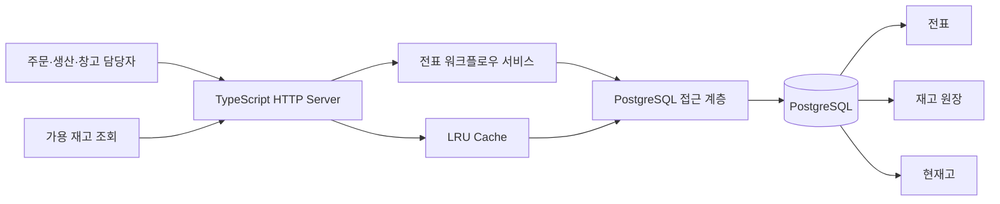
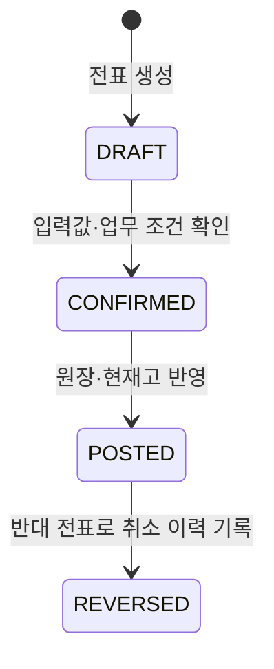

# Stock-Cock | 재고 서비스에서 출발한 TypeScript ERP 전표 서버 보강

현장에서 쓰는 재고·거래 관리 서비스 Stock-Cock을 바탕으로, 재고가 바뀌는 업무를 **전표 생성 → 확인 → 반영 → 취소 이력**으로 관리하는 TypeScript ERP 서버를 구현했습니다.

기존 서비스는 주문·생산·창고 담당자가 현재 재고와 입출고 이력을 모바일에서 확인하도록 만들었습니다. ERP 보강에서는 “수량을 바꿨다”에서 끝내지 않고, **누가 어떤 근거로 재고를 바꿨으며 그 결과가 원장과 현재고에 어떻게 남는가**를 서버의 책임으로 설계했습니다.

> **ERP 서버 구현 브랜치:** [`feature/erp-domain-lab`](https://github.com/enjoylonelines/stock-cock/tree/feature/erp-domain-lab)<br />
> 운영 서비스 `main`과 분리해 TypeScript·PostgreSQL 기반 전표 서버를 구현하고 검증했습니다.

## 30초 요약

| 항목 | 내용 |
| --- | --- |
| 출발점 | 엑셀로 나뉜 재고 관리에서는 변경 시점·담당자·사유를 확인하기 어려워 주문과 생산 판단 전에 창고를 다시 확인해야 했습니다. |
| 서버 문제 | 입고·출고·이동을 바로 수량에 반영하면 승인 책임, 재시도, 반려·취소 이력, 원장과 현재고의 일관성을 관리하기 어렵습니다. |
| 설계 | TypeScript HTTP 서버에서 전표 흐름을 관리하고, PostgreSQL에서 전표 상태·원장·현재고 반영을 하나의 처리 단위로 묶었습니다. |
| 구현 | 입고·출고·이동·반품·조정 전표, 상태 전이, 중복 요청 식별키, 단위 정규화, 테넌트 분리, 가용 재고 조회 캐시를 구현했습니다. |
| 검증 | HTTP 통합 검증으로 전표 반영, 중복 요청, 재고 부족 거절, 역분개, 원장·현재고 대사를 확인했습니다. |

## 서버 구조



### 각 계층이 맡는 일

| 계층 | 책임 |
| --- | --- |
| TypeScript HTTP Server | 전표 생성·확정·반영·역분개 요청을 받고 JSON 응답과 오류 코드를 반환 |
| 전표 워크플로우 서비스 | 전표 종류별 필수 값과 상태 전이 조건을 검사 |
| PostgreSQL 접근 계층 | 전표, 원장, 현재고를 읽고 쓰며 전표 반영을 DB 처리 단위로 실행 |
| PostgreSQL | 전표 이력, 재고 원장, 품목·창고별 현재고를 보관 |
| LRU Cache | 반복되는 가용 재고 조회를 저장하고 전표 반영·역분개 뒤 관련 값을 무효화 |

## 왜 ‘수량 변경’ 대신 ‘전표’로 처리했나

재고는 단순 숫자지만, 업무에서는 입고·출고·이동·반품·조정마다 근거와 책임이 다릅니다. 그래서 변경 요청을 먼저 전표로 만들고, 확인된 전표만 반영하도록 구성했습니다.



- **DRAFT**: 품목, 수량, 출발·도착 창고 등 요청값을 검증한 전표입니다.
- **CONFIRMED**: 업무 조건을 확인해 반영 가능한 상태로 전환한 전표입니다.
- **POSTED**: 전표 상태, 원장 항목, 현재고를 PostgreSQL에서 함께 반영한 상태입니다.
- **REVERSED**: 이미 반영한 기록을 지우지 않고, 반대 방향의 전표를 남겨 이력을 보존한 상태입니다.

## 구현한 핵심 업무 규칙

### 1. 입고·출고·이동·반품·조정을 하나의 모델로 표현

전표 유형마다 필요한 정보가 다릅니다. 입고는 도착 창고, 출고는 출발 창고, 이동은 서로 다른 두 창고, 반품은 원본 출고 전표와 연결해야 합니다. TypeScript 워크플로우 서비스에서 유형별 필수 값을 검사해 잘못된 요청이 DB 반영 단계까지 도달하지 않도록 했습니다.

### 2. 전표 반영 때 원장과 현재고를 함께 갱신

전표가 반영되면 PostgreSQL 접근 계층이 전표 상태, 재고 원장 항목, 품목·창고별 현재고를 함께 기록합니다. 따라서 “출고 전표는 남았지만 재고는 그대로인 상태”처럼 업무 이력과 현재 수량이 갈라지는 문제를 줄였습니다.

### 3. 재시도와 취소도 업무 이력으로 관리

전표 생성 요청에는 `idempotencyKey`를 사용해 같은 요청의 반복 처리를 식별합니다. 반영 취소는 기존 데이터를 삭제하는 대신 반대 전표를 만들고 반영해, 이전 기록과 취소 이유를 함께 추적할 수 있게 했습니다.

### 4. 입력 단위와 재고 기준 단위를 분리

사용자는 박스나 킬로그램 단위로 입력할 수 있지만, 재고 원장과 현재고는 비교 가능한 기준 단위로 계산돼야 합니다. 완제품은 `EA`, 포장 완제품은 `BOX = 24 EA`, 원재료는 `g`를 기준 단위로 두고 입력 단위를 보존하면서 기준 단위 수량을 계산했습니다.

### 5. 가용 재고 조회는 LRU Cache로 보조

가용 재고 조회는 품목·창고·테넌트를 키로 캐시에 저장합니다. 전표 반영 또는 역분개가 성공하면 해당 재고 키를 바로 무효화해, 변경 뒤에는 PostgreSQL의 최신 값을 다시 읽도록 했습니다.

## 검증한 흐름

전표 서버의 HTTP 통합 검증에서 다음 업무 흐름을 확인했습니다.

- 전표 생성부터 확정·반영까지의 상태 전이
- 같은 식별키로 요청했을 때 중복 전표가 생기지 않는 처리
- 재고가 부족한 출고를 거절하고 원장 항목을 만들지 않는 처리
- 출고·이동·반품·조정의 품목·창고 규칙 검사
- 테넌트별 전표·재고 조회 분리
- 역분개 뒤 전표 이력, 재고 원장, 현재고가 함께 맞는지 대사

## 기존 서비스에서 확인할 수 있는 업무 흐름

ERP 서버 보강은 실제 재고 관리 화면과 업무 흐름에서 출발했습니다. 아래는 로그인 후 재고·거래 이력을 확인하고, 제품과 입고를 기록하는 흐름입니다.

<table>
  <tr>
    <td width="33.3%" align="center" valign="top">
      <strong>01. 재고·거래 이력 확인</strong><br />
      <sub>로그인 → 현재고 요약 → 최근 거래 조회</sub><br /><br />
      
    </td>
    <td width="33.3%" align="center" valign="top">
      <strong>02. 제품과 초기 재고 등록</strong><br />
      <sub>제품 유형·창고·초기 수량 입력</sub><br /><br />
      
    </td>
    <td width="33.3%" align="center" valign="top">
      <strong>03. 입고 기록과 이력 반영</strong><br />
      <sub>창고·제품·수량 입력 → 거래 이력 확인</sub><br /><br />
      
    </td>
  </tr>
</table>

## 기술 구성

| 구분 | 사용 기술 |
| --- | --- |
| ERP Server | TypeScript, Node.js `node:http` |
| ERP Data | PostgreSQL, node-postgres, SQL Function |
| Server Design | 전표 워크플로우, 원장·현재고 처리, Idempotency Key, LRU Cache |
| Existing Service | TypeScript, Next.js App Router, Supabase Auth·PostgreSQL·Storage |
| UI / State | React, Tailwind CSS, shadcn/ui, SWR, Zustand |
| Quality / Deploy | Python integration test, Jest, Biome, PWA Service Worker, Vercel |

## 구현 레퍼런스

모든 ERP 서버 구현은 [`feature/erp-domain-lab`](https://github.com/enjoylonelines/stock-cock/tree/feature/erp-domain-lab) 브랜치에 있습니다.

| 확인 대상 | 링크 |
| --- | --- |
| TypeScript HTTP 서버 | [`http-server.ts`](https://github.com/enjoylonelines/stock-cock/blob/feature/erp-domain-lab/labs/erp-domain/ecount/backend/src/http-server.ts) |
| 전표 워크플로우 | [`inventory-document-workflow.ts`](https://github.com/enjoylonelines/stock-cock/blob/feature/erp-domain-lab/labs/erp-domain/ecount/backend/src/inventory-document-workflow.ts) |
| PostgreSQL 접근 계층 | [`postgres-workflow-port.ts`](https://github.com/enjoylonelines/stock-cock/blob/feature/erp-domain-lab/labs/erp-domain/ecount/backend/src/postgres-workflow-port.ts) |
| 전표·원장 스키마 | [`001_inventory_document_schema.sql`](https://github.com/enjoylonelines/stock-cock/blob/feature/erp-domain-lab/labs/erp-domain/ecount/sql/001_inventory_document_schema.sql) |
| 전표 반영 SQL | [`002_inventory_document_posting.sql`](https://github.com/enjoylonelines/stock-cock/blob/feature/erp-domain-lab/labs/erp-domain/ecount/sql/002_inventory_document_posting.sql) |
| HTTP 통합 검증 | [`http_integration.py`](https://github.com/enjoylonelines/stock-cock/blob/feature/erp-domain-lab/labs/erp-domain/ecount/test/http_integration.py) |
| 배포 서비스 | [stock-cock.vercel.app](https://stock-cock.vercel.app) |

## 실행

```bash
git switch feature/erp-domain-lab
pnpm install
docker compose -f labs/erp-domain/ecount/compose.yaml up -d
ERP_LAB_DSN=postgresql://... pnpm lab:erp:http
```

## 라이선스

MIT
