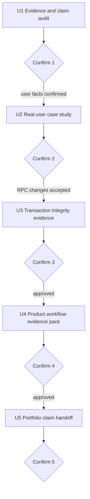

# docs: Build stock-cock real-user product evidence

## Summary

stock-cock을 AI 프로젝트로 바꾸지 않고, 실사용자가 있었던 제조 현장 재고관리 서비스로서 문제 발견, 제품화, DB 정합성, PWA 배포 경험을 증명한다. 사용자 수나 효과 수치는 만들지 않고 확인 가능한 사실과 사용자 제공 사실을 분리한다.

작업은 한 승인 단위씩 진행한다. 처음 이 문서를 읽었다면 U1만 수행하고 결과 보고 후 멈춘다.

---

## Working Agreement

1. 현재 작업 트리의 API, Supabase migration, 타입, 설정 변경은 사용자 소유 작업으로 보존한다.
2. 승인 없이 현재 RPC 변경을 수정·완료·되돌리지 않는다.
3. 실제 사용자에 관한 사실은 저장소만 보고 추정하지 않는다. 사용자가 확인한 내용만 기록한다.
4. 회사명, 사용자 이름, 내부 재고 수치 등 공개하면 안 되는 정보는 익명화한다.
5. AI, 수요예측, 자동발주, 챗봇을 보강 범위에 추가하지 않는다.
6. Live Demo 존재와 실제 업무 사용 성과를 같은 증거로 취급하지 않는다.
7. 각 승인 단위 종료 시 `Confirmation Report`를 작성하고 승인 전에는 다음 단위로 넘어가지 않는다.

---

## Current Baseline

- 제품 개요와 기술 선택: `README.md`
- 기술 면접 근거: `docs/TECH_QA.md`
- 설계 결정: `docs/TECHNICAL_DESIGN_DECISIONS.md`
- 테스트: `src/__tests__/`
- Supabase schema/migration: `supabase/migrations/`
- 입출고 원자 처리: `create_transaction` RPC와 `src/app/api/transactions/route.ts`
- 진행 중 변경: 이동·조정 RPC migration과 관련 API 수정
- 제품화 근거: Next.js App Router, Supabase, PWA, push notification, Vercel live demo

현재 `docs/TECH_QA.md`의 입출고 설명은 단계별 처리와 rollback 부재를 말하지만, 최신 코드는 `create_transaction` RPC를 사용한다. 이동·조정 RPC도 작업 트리에 진행 중이므로 문서 갱신은 해당 변경의 의도와 검증을 확인한 뒤 수행해야 한다.

---

## Requirements

### Real-User Evidence

- R1. 사용자가 누구였는지 공개 가능한 역할 수준으로 설명한다.
- R2. 기존 업무 문제, 사용 흐름, 실제 피드백, 반영 여부를 분리해 기록한다.
- R3. 사용자 수, 사용 빈도, 시간 절감 같은 수치는 근거가 있을 때만 사용한다.
- R4. Live Demo와 실제 사용 환경을 구분한다.

### Product and Engineering Evidence

- R5. `재고 확인 → 입출고/이동/조정 → 이력 → 알림` 흐름을 현재 코드에 연결한다.
- R6. DB transaction/RPC, PWA, push, migration을 사용자 문제 해결과 연결해 설명한다.
- R7. 현재 code와 오래된 문서가 충돌하면 검증 후 문서를 갱신한다.
- R8. 단위 테스트와 DB 통합 검증을 구분한다.

### Portfolio Safety

- R9. AI 기능을 추가하지 않는다.
- R10. 실제 사용자나 회사의 민감정보를 공개하지 않는다.
- R11. 테스트하지 않은 원자성·동시성·모바일 지원 범위를 확정 사실로 표현하지 않는다.

---

## Scope Boundaries

### In Scope

- 실사용자 문제와 피드백 근거 정리
- 핵심 업무 흐름과 현재 구현 연결
- 진행 중 RPC 변경의 검증 상태 확인
- PWA/push/배포의 제품 선택 근거
- 포트폴리오용 case study와 claim handoff

### Deferred Until Separate Approval

- 현재 dirty RPC 변경의 코드 수정
- 실제 Supabase DB reset/migration 적용
- Live Demo 데이터 변경
- 새 화면 또는 대규모 리팩터링

### Out of Scope

- 재고 예측 AI
- 자동 발주 추천
- LLM 챗봇
- 근거 없는 사용자 수와 성과 수치
- stock-cock을 대표 AI 프로젝트로 포지셔닝

---

## Approval Flow



---

## Key Technical Decisions

- KTD1. **실사용 사실은 사용자 확인이 source of truth다:** 코드와 배포는 사용 가능성을 보여주지만 실제 사용과 효과를 증명하지 않는다.
- KTD2. **현재 dirty RPC 작업을 계획이 소유하지 않는다:** 먼저 의도와 검증 상태를 보고하고 별도 승인 후 문서 근거로만 반영한다.
- KTD3. **제품 선택은 문제와 연결한다:** Supabase, PWA, push를 기술 나열이 아니라 1인·2주 MVP와 모바일 현장 접근 문제의 선택으로 설명한다.
- KTD4. **DB 원자성은 실행 검증 뒤 주장한다:** RPC 함수가 존재한다는 사실과 rollback/concurrency가 검증됐다는 사실을 구분한다.
- KTD5. **낮은 보강 강도를 유지한다:** 이 프로젝트의 역할은 실사용 제품 경험이며 AI 기능 수를 늘리는 것이 아니다.

---

## Implementation Units

### U1. Evidence and claim audit

- **Goal:** 코드 수정 없이 현재 claim, 문서 drift, dirty change, 사용자 확인이 필요한 사실을 분리한다.
- **Allowed changes:** 없음.
- **Inspect:** README, 기술 Q&A, 설계 문서, live demo 링크, screenshots, tests, migrations, git history와 현재 dirty files.
- **Required output:** `[code_verified]`, `[deployed]`, `[user_confirmed]`, `[unknown]`, `[stale_doc]`, `[work_in_progress]` claim 표.
- **User confirmation questions:** 실제 사용자 역할, 해결 전 업무 방식, 가장 자주 쓴 기능, 받은 피드백, 공개 가능 범위. 질문은 Confirmation 1에서 한 번에 3개 이하로 나눈다.
- **Stop conditions:** 실제 사용자 사실을 저장소 문구로 추정해야 함, dirty RPC 변경의 작성 의도 불명, live demo와 로컬 코드 버전이 다름.
- **Confirmation 1 tradeoff:** 익명성을 유지하면서 어느 수준까지 실제 업무 맥락을 공개할지 보고한다.

### U2. Real-user case study

- **Depends on:** Confirmation 1과 사용자 사실 확인.
- **Goal:** 검증된 사용자 사실만으로 한 장의 제품 사례를 만든다.
- **Files:** `docs/portfolio/REAL_USER_CASE_STUDY.md`
- **Required sections:** 사용자 역할, 기존 문제, 핵심 workflow, 선택한 해결책, 실제 피드백, 반영한 변경, 남은 불편, 공개 제한.
- **Rules:** 회사·개인 식별정보 익명화, 수치 없는 효과는 정성 결과로 표현, 본인 관찰과 사용자 발언 구분.
- **Verification:** 모든 사용자 claim에 `user_confirmed` 표시와 확인 날짜가 있고 코드 claim에는 source path가 있다.
- **Confirmation 2 report focus:** 제품 문제를 가장 잘 설명하는 3문장, 공개·비공개 경계, 과장 위험.

### U3. Transaction integrity evidence

- **Depends on:** Confirmation 2와 현재 RPC 변경을 유지할지에 대한 승인.
- **Goal:** 입출고·이동·조정의 현재 원자 처리 상태를 검증하고 오래된 문서를 고친다.
- **Default scope:** 검증과 문서 갱신만. 테스트에서 bug가 발견돼도 별도 승인 없이 제품 코드를 수정하지 않는다.
- **Files:**
  - `docs/TECH_QA.md`
  - `README.md`
  - `docs/portfolio/TRANSACTION_INTEGRITY_EVIDENCE.md`
  - 별도 승인 시 관련 tests
- **Verification targets:** `create_transaction`, `create_move_transaction`, `create_adjustment_transaction`, 재고 음수 정책, 같은 창고 이동, material/EA 단위, rollback, concurrent update, history reconstruction.
- **Test layers:** Jest mock test, Supabase migration validation, local DB integration test를 별도로 보고한다.
- **Stop conditions:** migration 미적용, RPC signature와 generated type 불일치, local DB 검증 불가, 음수 재고 정책 미확정.
- **Confirmation 3 tradeoff:** DB RPC로 얻은 원자성과 Supabase 종속성·migration 관리 비용을 함께 보고한다.

### U4. Product workflow evidence pack

- **Depends on:** Confirmation 3 approval.
- **Goal:** 실제 업무 흐름을 코드, 화면, 테스트, 배포 증거에 연결한다.
- **Files:**
  - `docs/portfolio/PRODUCT_WORKFLOW_EVIDENCE.md`
  - 기존 `public/screenshots/`는 덮어쓰지 않고 재사용 여부만 확인
- **Workflow:** 재고 확인 → 거래 기록 → 현재고 갱신 → 이력 확인 → push notification.
- **Evidence:** route/hook/domain path, migration, focused test, screenshot, live demo 상태.
- **PWA boundary:** iOS 설치·push 제약, service worker update, notification partial failure를 숨기지 않는다.
- **Verification:** README의 기술 선택과 실제 package/code가 일치하고, screenshot이 현재 UI를 오해시키지 않는지 확인한다.
- **Confirmation 4 report focus:** 제품화 강점, 모바일 tradeoff, live demo와 실제 사용의 차이.

### U5. Portfolio claim handoff

- **Depends on:** Confirmation 4 approval.
- **Goal:** 외부 포트폴리오에서 바로 사용할 수 있는 제한된 문장과 근거 링크를 만든다.
- **Files:** `docs/portfolio/STOCK_COCK_PORTFOLIO_HANDOFF.md`
- **Contents:** 프로젝트 한 문장, 실사용 문제 3문장, 핵심 workflow, 기술 결정 3개, 검증 결과, 사용자 피드백, 한계, 금지 claim, 예상 질문.
- **Positioning:** `실사용 업무 서비스와 제품화 경험`으로 두며 AI 역량 프로젝트와 구분한다.
- **Verification:** 모든 문장이 U1 상태표, U2 사용자 근거, U3/U4 기술 근거 중 하나에 연결된다.
- **Confirmation 5 report focus:** 채택 문장, 제외 문장, 공개 가능한 screenshot/수치, 외부 포트폴리오 반영 범위.

---

## Confirmation Report

```markdown
## stock-cock Confirmation N

### Result
- 상태, 수행 범위, 핵심 결론

### Evidence and Changes
- 변경 파일과 생성 산출물
- code/deploy/user evidence 상태
- 기존 dirty change와의 충돌 여부

### Verification
- unit/integration/manual 검증 결과
- 실행하지 못한 검증과 이유
- live demo와 local code 차이

### Tradeoffs
- 사용자 문제 해결 효과
- 기술 선택의 비용과 제약
- 선택하지 않은 대안과 이유

### Claims and Privacy
- 공개 가능한 문장
- 익명화 또는 제외할 정보
- 근거 없는 수치와 금지 claim

### Proposed Next Scope
- 다음 승인 단위, 허용 파일, 중단 조건

### Confirmation Request
- 진행 / 수정 / 재검증 요청
```

---

## Completion Criteria

- 실제 사용자 문제와 피드백이 사용자 확인 상태로 기록돼 있다.
- 핵심 업무 흐름이 코드·DB·테스트·화면 근거에 연결돼 있다.
- RPC 기반 정합성 claim이 현재 검증 수준과 일치한다.
- PWA/push의 이점과 iOS·delivery 제약이 함께 설명된다.
- AI 기능을 추가하지 않고 실사용 제품 경험이라는 프로젝트 역할이 선명하다.
- 포트폴리오 handoff의 모든 문장에 근거 상태가 붙어 있다.
